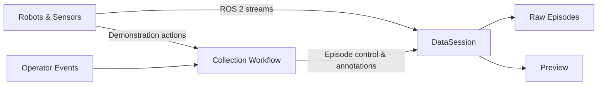

# PrometheusCollect

**Multimodal Demonstration Collection for Robotic Manipulation**

PrometheusCollect 是面向机器人操作研究的独立数据采集基础设施，支持主从遥操作与重力补偿拖拽示教。系统通过 ROS 2 管理机械臂与传感器数据，以 episode 为单位保存多模态观测、示教动作及交互事件，保留各数据流的原始采样频率和时间信息。

[部署与使用](docs/USAGE.md) · [硬件配置](docs/HARDWARE.md) · [数据格式](docs/DATA.md) · [验证记录](docs/RELEASE_CHECKS.md)

## 系统设计

- **原始数据保留**：异步录制多频率数据流，时间对齐与重采样由下游处理决定。
- **明确的动作语义**：区分遥操作命令目标与拖拽观测轨迹，保留动作来源元数据。
- **模块化资源管理**：HardwareSession、DataSession 与 EventSession 分别管理设备、数据和操作输入。
- **可复现配置**：通过 Hydra 组织实验配置，并锁定 YAM SDK 提交与兼容补丁。



## 采集平台

| 配置 | 示教方式 | 动作语义 |
| --- | --- | --- |
| `yam` | 双臂主从遥操作 | 发送给从臂的关节与夹爪目标 |
| `yam_drag` | 双从臂重力补偿拖拽 | 从臂关节与夹爪的观测位置 |
| `x5_1` / `x5_2` | ARX5 示教采集 | 当前适配器保存状态与传感器流，不单独输出 action |

传感器支持 RealSense RGB / IR 与 Xense 触觉。YAM 默认配置为三路 **640 × 480、30 Hz RGB** 和 **120 Hz 机器人状态发布**；实际采样率由记录时间戳确定。

## 快速开始

运行基线：**Ubuntu 24.04 · ROS 2 Jazzy · Python 3.12 · FFmpeg**。以下命令在项目根目录执行；系统依赖和设备配置见[部署指南](docs/USAGE.md)。

```bash
source /opt/ros/jazzy/setup.bash
uv venv --python /usr/bin/python3 --system-site-packages .venv
uv pip install --python .venv/bin/python -e '.[realsense]'

# Prepare and install the pinned YAM SDK.
.venv/bin/python scripts/prepare_yam_i2rt.py --output outputs/dependencies/i2rt-yam
uv pip install --python .venv/bin/python \
  -c scripts/constraints-yam.txt --build-constraint scripts/build-constraints-yam.txt \
  outputs/dependencies/i2rt-yam
```

完成设备配置后，选择一种模式启动采集：

```bash
# Leader–follower teleoperation
bash scripts/start_data_collection.sh robot=yam user.task_id=my_task

# Gravity-compensated kinesthetic teaching
bash scripts/start_data_collection.sh robot=yam_drag user.task_id=my_task
```

数据默认写入 `$HOME/prometheus_data/<task_id>/`，可用 `user.collect_root` 覆盖。键盘、踏板及模式相关的归位与退出行为见[操作指南](docs/USAGE.md#3-采集流程)。

## 数据组织

```text
<episode>/
├── camera/       # Videos, timestamps, calibration metadata when configured
├── tactile/      # Optional tactile observations
├── robot/        # Joint state and available end-effector observations
├── action/       # Demonstration actions, when provided by the driver
├── event/        # Operator annotations
└── manifests/    # Recording status and modality-level statistics
```

YAM 动作为 14 维 `abs_qpos`，按左臂六关节、左夹爪、右臂六关节、右夹爪排列；关节单位为 rad，夹爪开口单位为 m。未提供的 EEF 观测保留为空。各模态按实际数据生成文件，格式约定见[数据文档](docs/DATA.md)。

## 验证与复现

无需硬件即可验证安装与 episode 保存：

```bash
.venv/bin/prometheus-collect --config-name collect_noop
```

2026-09-14 的软件验证包含 **164 项数采测试通过、26 项 I2RT 测试通过**；另有 **3 项真实设备测试跳过**。测试范围及实机验证边界见[验证记录](docs/RELEASE_CHECKS.md)。

完整测试、数据查看、可选上传及打包方式见[使用指南](docs/USAGE.md)。
