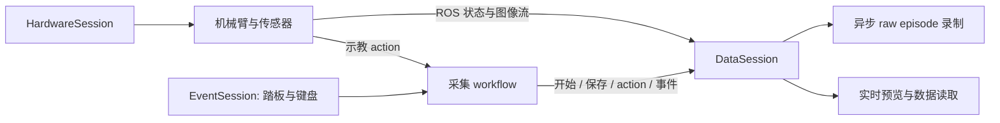

# 使用与部署指南

面向机器人示教的数据采集基础设施。统一管理机械臂、相机、触觉传感器和操作输入，将多路原始数据按 episode 保存，并提供实时预览、离线查看和可选的 ModelScope 上传。

项目独立运行，不依赖其他 Prometheus 仓库；不包含模型训练、策略推理、DAgger 或模型服务。Python 包名为 `prometheus`，发行包名为 `prometheus-collect`。

| 采集模式 | 设备与操作 | 记录的 action |
| --- | --- | --- |
| `robot=yam` | 两只 YAM 主臂通过教学手柄控制两只 YAM Ultra 2 从臂 | 实际发送给从臂的关节与夹爪目标 |
| `robot=yam_drag` | 仅连接两只从臂，在重力补偿下手动拖拽 | 观测到的从臂关节与夹爪位置 |
| `robot=x5_1` / `robot=x5_2` | ARX5 示教采集，按配置接入相机和 Xense 触觉 | 当前适配器保存状态与传感器流，不单独写出 action |

YAM 默认采集三路 **640×480、30 Hz RGB**，机器人状态发布配置为 **120 Hz**。这是配置频率，实际采样率和间隔应从保存的时间戳检查。

## 1. 环境与安装

### 系统要求

当前验证基线为 **Ubuntu 24.04、ROS 2 Jazzy、Python 3.12**。真实设备采集需要对应 SDK；无硬件安装检查只需基础 Python 包。

| 依赖 | 用途 |
| --- | --- |
| ROS 2 Jazzy | 机器人状态、相机和触觉数据的进程间传输 |
| FFmpeg，包含 `libx265` 编码器 | 默认 RGB 视频录制 |
| Tk / `python3-tk` | 本地预览窗口；无桌面环境可用 Web 预览 |
| 带兼容补丁的 I2RT | YAM 驱动、重力补偿与机器人模型计算 |
| `pyrealsense2` | RealSense 相机 |
| ARX5 SDK、`xensesdk` | 仅对应设备需要，YAM 采集不加载它们 |

以下命令使用 Bash，并在项目根目录执行。先安装 ROS 2 Jazzy 和 `uv`，再创建项目环境。使用独立 `.venv`，避免与原版 `prometheus-v3` 共用同一个 Python 包路径。

```bash
cd /home/romoya-2/data_collection/PrometheusCollect
# 部署到其他位置时，将上面的目录替换为实际路径。

sudo apt install git build-essential cmake ninja-build python3-dev python3-venv \
  ffmpeg python3-tk ros-jazzy-cv-bridge ros-jazzy-sensor-msgs-py

source /opt/ros/jazzy/setup.bash
uv venv --python /usr/bin/python3 --system-site-packages .venv
uv pip install --python .venv/bin/python -e '.[realsense,test]'
```

`--system-site-packages` 用于访问系统 ROS 的 Python 模块。项目将 NumPy 约束为 1.x，以兼容当前 ROS 扩展。基础安装可只使用 `uv pip install --python .venv/bin/python -e .`；`realsense` 和 `test` 分别是相机、测试依赖。

### 安装 YAM SDK

使用项目提供的准备脚本获取锁定的 I2RT 提交并应用兼容补丁：

```bash
.venv/bin/python scripts/prepare_yam_i2rt.py \
  --output outputs/dependencies/i2rt-yam

uv pip install --python .venv/bin/python \
  -c scripts/constraints-yam.txt \
  --build-constraint scripts/build-constraints-yam.txt \
  outputs/dependencies/i2rt-yam
```

准备脚本会校验补丁 SHA-256，再生成独立源码目录。输出目录必须不存在；已经成功准备过的目录可直接用于安装。依赖身份见 [I2RT 锁定文件](../third_party/i2rt_release/lock.json) 和 [补丁说明](../third_party/i2rt_release/README.md)。

已有包含锁定提交的本地 I2RT Git 仓库时，可离线准备源码：

```bash
.venv/bin/python scripts/prepare_yam_i2rt.py \
  --source /path/to/i2rt --output outputs/dependencies/i2rt-yam
```

在线获取与本地导出是两种可选方式，选一种执行即可。脚本读取 Git 中的锁定提交，不复制该仓库的未提交改动。后续安装依赖仍需网络或本地缓存。安装完成后，采集不依赖这个外部 Git 仓库。

普通上游 I2RT 缺少本项目使用的部分接口，不能直接替代。I2RT 的 MuJoCo 是重力补偿依赖；无需安装 Rerun 或训练库。

### 检查安装

下面的采集检查不会打开 CAN、相机或踏板，也不要求 ROS / I2RT 可用：

```bash
.venv/bin/prometheus-collect --config-name collect_noop
```

成功时会打印 `[record] saved episode=0000`，并在 `outputs/collect_noop/<run_id>/` 写入运行清单和一条仅含事件的 episode。这只验证安装与录制链路，不代表硬件已经可用。

真实采集环境还可先检查模块和视频编码器，不启动设备：

```bash
source /opt/ros/jazzy/setup.bash
.venv/bin/python -c 'import rclpy, cv_bridge, sensor_msgs_py, pyrealsense2, i2rt; print("imports OK")'
ffmpeg -hide_banner -encoders
```

确认 FFmpeg 输出包含 `libx265`。ARX5 / Xense 的安装和踏板 udev 设置见 [设备配置](HARDWARE.md)。

## 2. 配置采集设备

配置入口为 [collect.yaml](../prometheus/configs/collect.yaml)，默认选择 `robot=yam`。设备配置保留了当前采集台的 CAN 名称、相机序列号和机械参数，换设备时应核对：

| 配置 | 文件 / 默认值 |
| --- | --- |
| YAM 主从臂 | [yam.yaml](../prometheus/configs/robot/yam.yaml) |
| YAM 拖拽 | [yam_drag.yaml](../prometheus/configs/robot/yam_drag.yaml) |
| ARX5 | [x5_1.yaml](../prometheus/configs/robot/x5_1.yaml)、[x5_2.yaml](../prometheus/configs/robot/x5_2.yaml) |
| 主臂 CAN | `can_leader_l`、`can_leader_r` |
| 从臂 CAN | `can_follower_l`、`can_follower_r` |
| 相机逻辑位置 | `base_0`、`left_wrist_0`、`right_wrist_0` |
| ROS domain | 控制 / 状态 `21`，相机 / 触觉 `22` |
| 踏板设备 | `/dev/input/prometheus-pedal` |

启动脚本默认将 ROS 通信限制在本机。修改 domain 时，采集和诊断命令应使用一致的值。

Hydra 支持从命令行覆盖配置。下面的命令只打印最终配置，**不启动设备**：

```bash
bash scripts/start_data_collection.sh robot=yam_drag \
  robot.robot.follower_can.left=can0 \
  robot.robot.follower_can.right=can1 \
  'robot.cameras.serial_no.base_0="YOUR_CAMERA_SERIAL"' \
  user.task_id=my_task user.collect_root=/data/demonstrations \
  --cfg job --resolve
```

将序列号和 CAN 名称改成实际值后，去掉 `--cfg job --resolve` 即可采集。相机序列号应作为字符串传入。更换采集台还需核对机械臂、夹爪型号、夹爪行程及拖拽补偿参数，不能只替换 CAN 名称。

常用覆盖项：

| 参数 | 默认值 / 含义 |
| --- | --- |
| `user.task_id` | `demo`，决定任务数据子目录 |
| `user.collect_root` | `$HOME/prometheus_data`，可通过 `PROMETHEUS_DATA_ROOT` 设置默认值 |
| `user.log_root` | `/tmp/prometheus_logs`，需要长期保留运行日志时设为持久目录 |
| `user.max_episodes` | `25`，本次运行完成的 episode 上限，须为正整数 |
| `event.input_source` | `pedal,tty`；无踏板时设为 `tty` |
| `workflow.preview.enabled` | `true` |
| `workflow.preview.mode` | `local`，也可设为 `web` |
| `workflow.quiet_hardware_logs` | `true`，就绪后隐藏常规硬件日志，保留警告和错误 |
| `data.recording.enable_plots` | `true`，保存时生成状态曲线图 |

需要同时指定踏板和键盘时，写成 `'event.input_source="pedal,tty"'`，避免 Hydra 将逗号解释为多次运行参数。默认配置已经启用两者，无需重复覆盖。

## 3. 采集流程

每次开新终端，先加载 ROS，再激活项目环境：

```bash
cd /home/romoya-2/data_collection/PrometheusCollect
source /opt/ros/jazzy/setup.bash
source .venv/bin/activate
```

以下两种 YAM 模式选择一种运行。同一组机械臂和相机由一个采集进程持有。

### YAM 主从臂

```bash
bash scripts/start_data_collection.sh robot=yam \
  user.task_id=my_task user.max_episodes=25
```

1. 等待 `[ready] Prometheus data collection is ready.`。
2. 分别按下左右教学手柄的使能键，使两侧完成对齐并进入跟随。使能键是**按下切换状态**：再次按下会解除该侧跟随，无需一直按住。
3. 在启动采集的终端按 `a`，看到 `[record] started` 后进行示教。开始录制要求两侧均已同步。
4. 按 `b` 保存，等待 `[record] saved`。主从模式保存后不会自动回 Home，可以继续下一条。
5. 需要返回 Home 时先保存当前 episode，再按 `r`；返回后重新按两侧使能键同步。

首次使用 Home，应先把机械臂放到合适的停放姿态，再按 `h` 记录。主从模式把主、从臂姿态写入 Home 文件，返回时只驱动从臂。

### YAM 从臂拖拽

```bash
bash scripts/start_data_collection.sh robot=yam_drag \
  user.task_id=my_task user.max_episodes=25
```

1. 启动时仅连接两只从臂，进入重力补偿，并记录本次启动姿态作为返回目标。
2. 等待 `[ready]`，按 `a` 开始，直接拖动机械臂和夹爪完成示教。
3. 按 `b` 保存。默认在保存成功后用约 **8 秒**返回目标姿态，再恢复重力补偿；等待返回完成后开始下一条。
4. 如需把当前姿态设为新的返回目标，按 `h`；空闲时可按 `r` 手动返回。

拖拽模式的返回目标保存在当前进程内；`h` 同时会写出姿态快照，但重新启动后会重新捕获启动姿态，不从旧快照恢复目标。

关闭拖拽返回功能：

```bash
bash scripts/start_data_collection.sh robot=yam_drag \
  robot.robot.return_to_start_enabled=false user.task_id=my_task
```

该开关同时关闭保存后的自动返回和手动返回能力；关闭后不要使用 `h`，当前实现会报错并退出采集。`workflow.home_return.on_episode_stop=false` 不能单独关闭拖拽模式的自动返回，应使用上面的驱动开关。

需要检查拖拽手感时，先结束占用同一 CAN 的采集程序，再运行：

```bash
bash scripts/start_yam_drag_teach.sh
```

此工具读取 `yam_drag.yaml` 并直接连接机械臂，用于查看拖拽状态；不启动 ROS、相机或录制。可用 `bash scripts/start_yam_drag_teach.sh --help` 查看临时覆盖参数。

### 键盘、踏板与退出

以下操作基于默认 `collect` 配置。键盘输入由**启动采集的终端**读取，操作时保持终端焦点。

| 键盘 | 踏板 | 操作 |
| --- | --- | --- |
| `a` | 1 | 开始录制；正在录制时重复开始会被忽略 |
| `b` | 2 | 停止并保存；空闲时忽略 |
| `c` | 3 | 给当前 episode 写入事件标记 |
| `h` | 无 | YAM 记录当前姿态；拖拽模式还更新返回目标 |
| `r` | 无 | 空闲时返回目标姿态；录制中忽略 |
| `q` | 4 | 保存当前 episode 并退出 |
| Ctrl-C | 无 | 保存当前 episode 并退出 |

键盘单按即可。踏板需在 **1 秒内双踩同一键**，默认去抖间隔为 0.25 秒。无踏板时在启动命令添加 `event.input_source=tty`。

默认 `q` / Ctrl-C 退出不会自动归位，退出会释放电机力矩，应先把机械臂放到有支撑的姿态。拖拽模式若希望保存后完成自动返回再退出，先按 `b` 并等待返回结束，再按 `q`。保存或硬件故障时，以错误信息和保存清单为准。

Home 返回使用限幅关节轨迹，不提供避障规划。默认每个关节的返回位移上限为 2 rad；被拒绝时应检查当前姿态、目标和路径。主从模式 Home 文件还会校验从臂 CAN 映射。`h` 会覆盖目标文件，不同采集台建议使用不同的数据根目录或 `workflow.home_capture.path`。

### 预览

默认使用本机 Tk 窗口。预览窗口中的 `q` 或关闭按钮只关闭预览，不等于退出采集。

```bash
# Web 预览：在采集主机浏览器打开 http://127.0.0.1:7860
bash scripts/start_data_collection.sh robot=yam_drag workflow.preview.mode=web

# 无预览、仅键盘控制
bash scripts/start_data_collection.sh robot=yam_drag \
  event.input_source=tty workflow.preview.enabled=false
```

本地窗口刷新配置为 20 Hz，与相机的 30 Hz 采集配置分开。未设置 `DISPLAY` 时，本地窗口会被禁用；录制控制仍在终端或踏板中。

## 4. 数据、日志与查看

YAM 采集的默认目录布局：

```text
$HOME/prometheus_data/
├── yam_home.json                     # 按 h 保存的姿态快照
└── <task_id>/
    ├── 0000/
    │   ├── camera/
    │   │   ├── base_0_color.mp4      # 另有左右腕部视频
    │   │   ├── timestamp.pkl
    │   │   └── metadata.json
    │   ├── robot/robot_state_dict.pkl
    │   ├── action/executed_action_dict.pkl
    │   ├── event/event_dict.pkl
    │   ├── manifests/               # camera / tactile / robot / action / event
    │   └── state_joint_vis.png      # 启用绘图且生成成功时
    └── 0001/
```

目录和文件按实际数据生成；启用 IR 或触觉时会增加对应文件。新运行会接着任务目录下已有的最大数字编号创建 episode，不覆盖已有编号。

运行清单位于 `<user.log_root>/collect/<task_id>/<run_id>/workflow_manifest.json`，记录开始数、保存数、退出原因、硬件状态和清理错误；Hydra 配置快照位于项目 `outputs/hydra/collect/<run_id>/.hydra/`。`q` / Ctrl-C 的正常用户中断记录为 `interrupted`，进程返回码为 `130`；达到 episode 上限后正常完成返回 `0`。

数据约定：

- 保留相机、机器人、action 和事件的原始多频率数据，不在采集阶段统一重采样。
- 在线样本使用纳秒时间戳；原始 PKL 中常用的 `timestamps` 列表以毫秒保存，部分 metadata 保留纳秒值。处理时按字段区分单位。
- YAM action 为 14 维 `abs_qpos`：左侧 J1–J6、左夹爪、右侧 J1–J6、右夹爪。关节位置单位为 rad，夹爪开口为 m。
- 主从 action 是命令目标，拖拽 action 是观测位置；应保留其 metadata 以区分来源。
- YAM 未声明 EEF 流，`eef` 保持 `None`，完整性检查和绘图不要求 EEF。
- 队列溢出、编码失败或已检测到的硬件故障会使当前 episode 失败；应检查 `manifests/` 中的状态、错误和缺失计数，不能只看视频文件是否存在。

查看已经采集的 episode：

```bash
.venv/bin/prometheus-episode "$HOME/prometheus_data/my_task/0000"
```

命令启动离线数据 Web 查看器，默认访问 `http://127.0.0.1:7860`，用 Ctrl-C 结束。可通过 `--port 7861` 避开实时预览占用的端口。

也可以在 Python 中读取可信的本地采集结果：

```python
from pathlib import Path
from prometheus.data.episode import RawEpisodeReader

reader = RawEpisodeReader(Path.home() / "prometheus_data/my_task/0000")
print(reader.counts())
print(reader.status())
```

更详细的字段说明见 [数据格式](DATA.md)。

## 5. 可选上传

基础采集不依赖上传 SDK。先显式选择本地任务目录和 ModelScope 仓库，默认只在本地检查文件，不登录或上传：

```bash
.venv/bin/prometheus-upload \
  local_dir=/data/demonstrations/my_task repo_id=YOUR_NAME/YOUR_DATASET
```

检查结果位于 `outputs/modelscope_upload/<run_id>/files.json` 和 `result.json`。正式上传时安装额外依赖，并显式设置 `dry_run=false`：

```bash
uv pip install --python .venv/bin/python -e '.[upload]'
.venv/bin/prometheus-upload \
  local_dir=/data/demonstrations/my_task repo_id=YOUR_NAME/YOUR_DATASET \
  dry_run=false
```

程序会在交互终端隐藏输入访问令牌，也支持 `MODELSCOPE_API_TOKEN` 环境变量。默认检查 episode 已成功保存，使用已有仓库，不创建仓库、不删除远端文件。上传配置见 [upload_dataset.yaml](../prometheus/configs/upload_dataset.yaml)。

需要单独维护上传环境时，使用随项目提供的入口：

```bash
uv venv --python /usr/bin/python3 .venv-modelscope-upload
uv pip install --python .venv-modelscope-upload/bin/python -r scripts/requirements-upload.txt
bash scripts/upload_dataset.sh \
  local_dir=/data/demonstrations/my_task repo_id=YOUR_NAME/YOUR_DATASET
```

## 6. 常见问题

| 现象 | 检查与处理 |
| --- | --- |
| `No module named rclpy` / `cv_bridge` | 先 source ROS；使用系统 Python 3.12 和带 `--system-site-packages` 的项目环境 |
| `Collection Python not found` | 按安装步骤创建 `.venv`，或通过 `PYTHON_BIN=/path/to/python` 指定已装好依赖的解释器 |
| `Incompatible I2RT` | 用项目锁定提交和补丁重新准备、安装 SDK；检查解释器实际加载的 `i2rt` 路径 |
| 踏板找不到或无权限 | 检查 `/dev/input/prometheus-pedal`、udev 规则和用户组；临时改用 `event.input_source=tty` |
| 按 `a` 没有开始 | 保持终端焦点；主从模式确认左右手柄均完成同步，并查看 `start ignored` 提示 |
| 相机就绪超时 | 核对三路序列号、USB 连接和设备占用；默认等待全部声明的数据流就绪 |
| 本地预览不出现 | 检查 `DISPLAY`、`python3-tk`，或使用 `workflow.preview.mode=web` |
| `Address already in use` | 修改 `workflow.preview.port`，或给离线查看器传入其他 `--port` |
| Home 返回被拒绝 | 检查是否已录入 Home、从臂 CAN 映射、目标位置和位移限制；录制期间先按 `b` 保存 |
| 拖拽关闭返回后按 `h` 报错退出 | `return_to_start_enabled=false` 时不能捕获返回目标；重启时恢复功能后再使用，或保持手动摆放且不按 `h` |
| 保存失败或录制卡顿 | 查看运行清单、各模态 manifest、FFmpeg 错误及磁盘空间；队列溢出会使 episode 失败 |
| 日志过少，无法定位问题 | 启动时添加 `workflow.quiet_hardware_logs=false`；相机诊断可加 `data.bridge.print_camera_rates=true` |

需要检查正在运行的 ROS 流时，可在另一个已加载 ROS 的终端执行只读订阅诊断：

```bash
.venv/bin/python scripts/check_stream_sync.py \
  --robot-id yam_drag --control-domain 21 --sensor-domain 22 --duration-s 15
```

该脚本不启动设备。主从模式改用 `--robot-id yam`。YAM 没有发布 EEF 流，因此诊断中左右 EEF 无样本是预期行为；频率和时间间隔以机器人状态与相机流为准。

## 7. 架构与扩展



| 模块 | 职责 |
| --- | --- |
| `prometheus/workflows/` | 采集、上传入口；组织 session 和 episode 状态 |
| `prometheus/sessions/` | 硬件、数据、输入事件的启动、就绪、健康和关闭边界 |
| `prometheus/nodes/robots/` | YAM / ARX5 驱动及通用 ROS owner、控制客户端 |
| `prometheus/nodes/sensors/` | RealSense / Xense 数据发布 |
| `prometheus/data/` | 缓冲、时间对齐、异步录制、离线读取和绘图 |
| `prometheus/visualization/` | 采集预览 |
| `prometheus/configs/` | Hydra 工作流和设备配置 |
| `scripts/`、`config/input/` | 启动、SDK 准备、诊断和踏板规则 |
| `third_party/i2rt_release/` | I2RT 提交锁定及兼容补丁 |
| `tests/` | 软件回归和显式启用的设备测试 |

新增设备时，驱动实现 `RobotDriver` 的 `connect()`、`read_state()`、`send_action()`、`close()` 和 `status()`，由设备 resolver 声明 driver、owner、client、sensors 与 streams，再交给 `HardwareSession` 管理。`DataSession` 统一负责订阅与录制；新数据模态还需补充对应 writer，不能只发布一个新 topic 就假定它会被保存。

默认入口是 `collect`。`record_drag` 保留为底层工作流配置，控制映射和输出位置与 `collect` 有差异；无硬件检查使用 `collect_noop`。安装后也可直接调用 `prometheus-collect` 或 `python -m prometheus.workflows.record_drag`，均默认加载 `collect`。

## 8. 测试与打包

完整软件回归需要已安装测试依赖、YAM SDK，并加载 ROS；下列命令显式禁用真实设备测试：

```bash
source /opt/ros/jazzy/setup.bash
PYTEST_DISABLE_PLUGIN_AUTOLOAD=1 \
PROMETHEUS_LIVE_ARX5=0 PROMETHEUS_LIVE_PEDAL=0 PROMETHEUS_LIVE_REALSENSE=0 \
  .venv/bin/python -m pytest -q
```

`PYTEST_DISABLE_PLUGIN_AUTOLOAD=1` 避免系统 ROS 的外部 pytest 插件干扰此项目测试。2026-09-14 的拆分验证结果为 **164 项通过、3 项设备测试跳过**，I2RT 相关测试 **26 项通过**；另已验证独立 wheel 安装和无硬件录制。该结果不等于实机验收，现场仍需检查返回轨迹、拖拽助力、释放行为和连续采集质量。详见 [验证记录](RELEASE_CHECKS.md)。

构建源码包与 wheel：

```bash
uv build --python .venv/bin/python
```

产物位于 `dist/`：

- `prometheus_collect-0.1.0.tar.gz`：README、代码、配置、SDK 准备脚本、设备规则和测试。
- `prometheus_collect-0.1.0-py3-none-any.whl`：采集 Python 包、Hydra 配置和命令行入口。

实际 YAM 部署仍需安装 ROS、FFmpeg 和兼容 I2RT；wheel 不捆绑这些依赖，也不捆绑数据集或虚拟环境。跨机器部署时重新创建环境。开发约定见 [AGENTS.md](../AGENTS.md)，源码拆分来源见 [SOURCE_SNAPSHOT.json](SOURCE_SNAPSHOT.json)。
